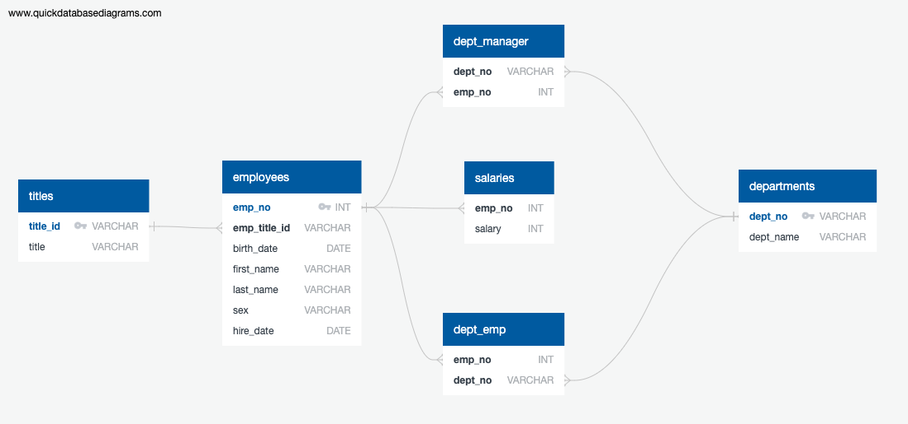
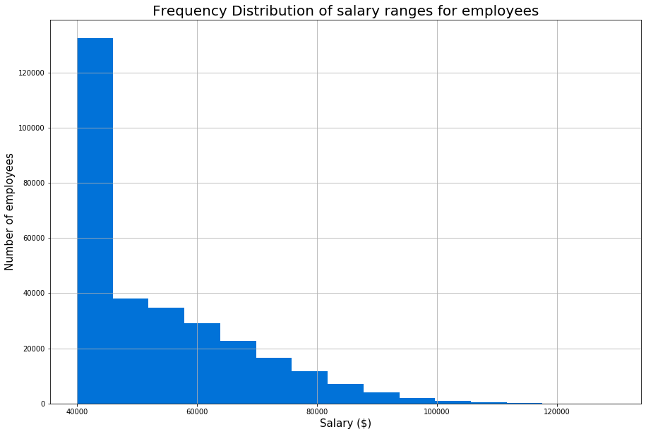
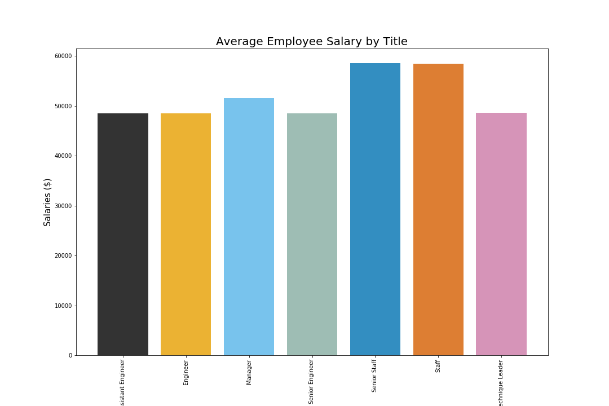

# Employee Database: A Mystery in Two Parts


Data modeling, data engineering and SQL analysis of **Pewlett Hackard**'s employee records from 1985–2000. Six CSV files are rebuilt into a normalized PostgreSQL database, queried, and then checked in Python, where a few clues show the data isn't what it seems.


## At a glance

| Table | Rows |
|---|---:|
| `employees` | 300,024 |
| `salaries` | 300,024 |
| `dept_emp` | 331,603 |
| `dept_manager` | 24 |
| `departments` | 9 |
| `titles` | 7 |

## 1. Data modeling

An entity-relationship diagram identifies six entities, their attributes, and the primary and foreign keys that connect them.



Source: [`Employees_db_ERD_modeling.txt`](EmployeeSQL/ERD/Employees_db_ERD_modeling.txt) (QuickDBD format) · [PDF](EmployeeSQL/ERD/Employees_db_modeling.pdf)

## 2. Data engineering

[`Employees_db_schema.sql`](EmployeeSQL/Employees_db_schema.sql) creates every table with data types, primary keys and foreign-key constraints. Because of the foreign keys, **import the CSVs in this order**:

`departments` → `titles` → `employees` → `dept_emp` → `dept_manager` → `salaries`

## 3. Data analysis

[`Employees_db_Query.sql`](EmployeeSQL/Employees_db_Query.sql) answers eight questions:

| # | Question | Rows |
|---|---|---:|
| 1 | Employee number, name, sex and salary of each employee | 300,024 |
| 2 | Employees hired in 1986 | 36,150 |
| 3 | Manager of each department | 24 |
| 4 | Department of each employee | 331,603 |
| 5 | Employees named "Hercules B…" | 20 |
| 6 | Employees in Sales | 52,245 |
| 7 | Employees in Sales and Development | 137,952 |
| 8 | Frequency of each last name (most common: *Baba*, 226) | 1,638 |

## 4. Testing and validation in Python

[`Employees_db_testing.ipynb`](EmployeeSQL/Employees_db_testing.ipynb) reads the database straight into Pandas with SQLAlchemy and charts it:

| Salary distribution | Average salary by title |
|---|---|
|  |  |

### 🕵️ The mystery

The charts don't look like a real company:

- **Pay is upside-down.** *Staff* and *Senior Staff* average about **$58.5k**, more than *Managers* ($51.5k), while every engineering title, *Senior Engineer* included, sits at about **$48.5k**.
- **The salary floor is a wall.** **52.8%** of employees earn under $50k, and the minimum is exactly **$40,000**.
- **Then there's employee 499942:**

| emp_no | first_name | last_name | title |
|---|---|---|---|
| 499942 | April | **Foolsday** | Technique Leader |

The dataset is synthetic. 🙂

## Getting started

**Prerequisites:** PostgreSQL 12+ and Python 3 with `pandas`, `sqlalchemy`, `psycopg2-binary`, `matplotlib` and `seaborn`.

```bash
git clone https://github.com/ermiasgelaye/sql-challenge.git
cd sql-challenge/EmployeeSQL

createdb Employees_db
psql -d Employees_db -f Employees_db_schema.sql

for t in departments titles employees dept_emp dept_manager salaries; do
  psql -d Employees_db -c "\copy $t FROM 'data/$t.csv' CSV HEADER"
done

psql -d Employees_db -f Employees_db_Query.sql
```

To run the notebook, put your PostgreSQL credentials in `config.py`:

```python
username = "postgres"
password = "YOUR_PASSWORD"
```

## Project structure

```
sql-challenge/
└── EmployeeSQL/
    ├── Employees_db_schema.sql     # tables, keys and constraints
    ├── Employees_db_Query.sql      # analysis queries
    ├── Employees_db_testing.ipynb  # SQLAlchemy + Pandas validation
    ├── config.py                   # database credentials (placeholder)
    ├── data/                       # six source CSVs
    ├── ERD/                        # ER diagram (PNG, PDF, QuickDBD source)
    └── Images/                     # README images
```

## Author

**Ermias Gelaye** · [Portfolio](https://ermiasgelaye.github.io) · [GitHub](https://github.com/ermiasgelaye)
